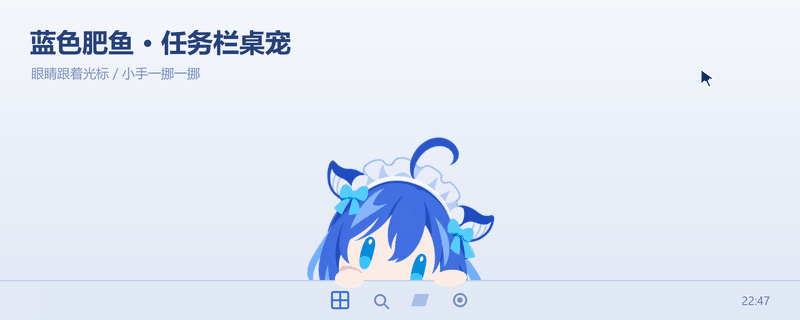
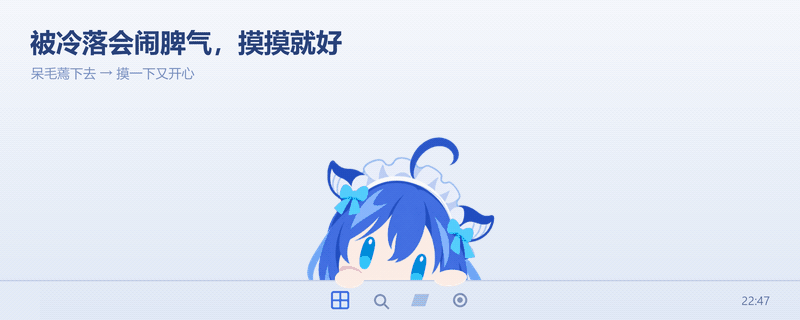
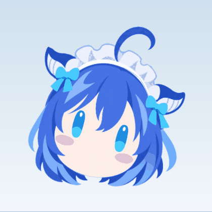
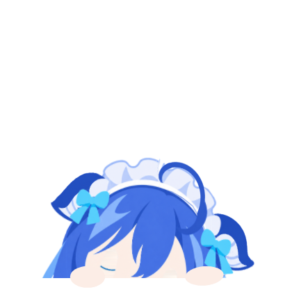
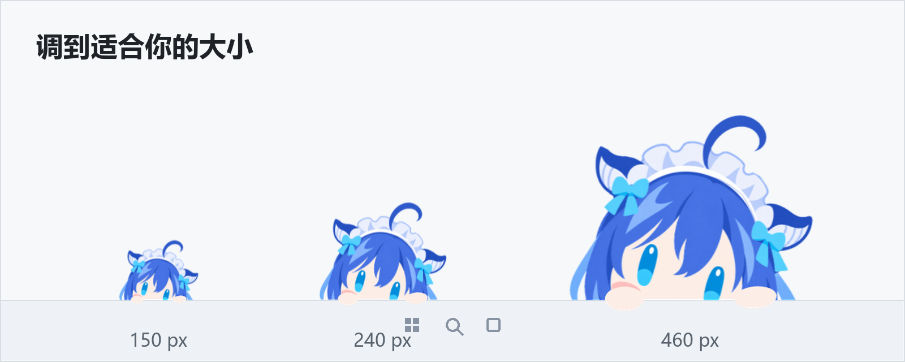
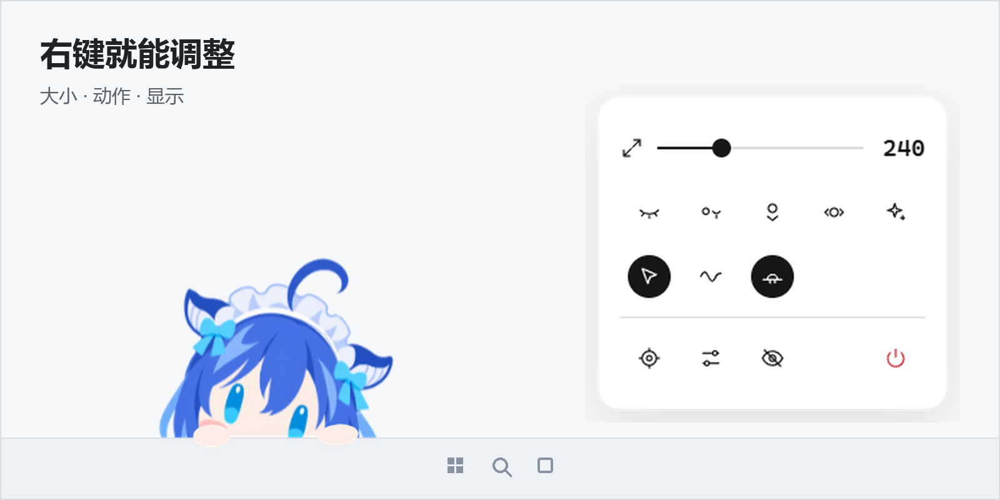
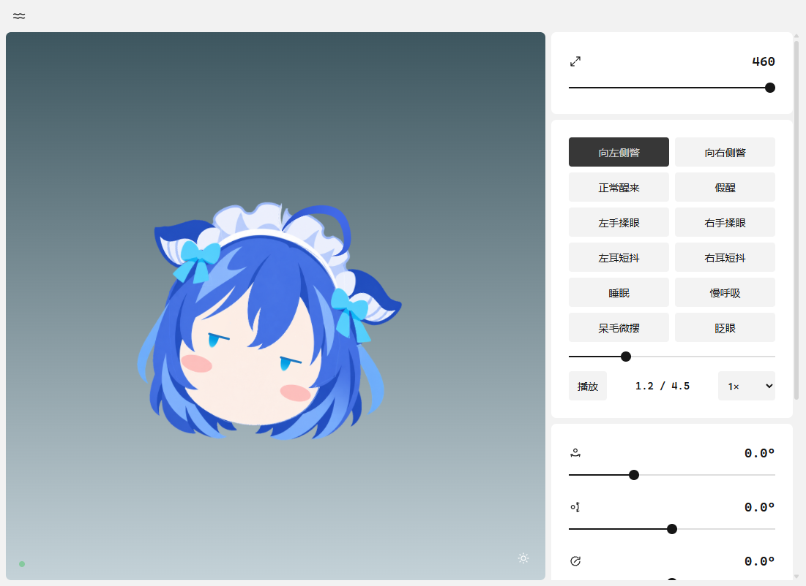

<div align="center">

# 蓝色肥鱼 · Bluefish

趴在 Windows 任务栏上的桌面小角色。



</div>

## 她会

- 眼睛和脑袋跟着光标走
- 每次揉头随机反应：约 20% 放松闭眼、50% 睁眼晃脑袋和呆毛、30% 只轻轻摇晃；短暂移出再回来保持同一种反应
- 闭眼反应离开后随机等待 2–5 秒，双眼睁开后才恢复移动；闭眼大多同步，偶尔轻微错开
- 光标久停或离远后逐渐停止注视、萎靡；靠近移动后恢复精神
- 不与她互动 2 分钟后开始有概率睡着，概率随时间增加，10 分钟必定入睡；睡着后趴得更低、闭眼、耳尖更耷拉，小手仍搭在任务栏上
- 再次靠近移动、揉头或点击会唤醒她，先睁眼再抬头；隐藏到托盘的闲置时间也计入
- 耳朵快速从耳根传到耳尖，伴随向内扭转、轻微弯曲和回弹
- 小手挪动时轻轻抬起，幅度缩小到原来的约三分之一
- 朝一边看久了，两只小手一抬一落，挪过去
- 半天不理她：挪回原位，扭头，呆毛蔫下去，两只耳朵也耷拉下来
- 摸摸她：转回来，呆毛晃起来，耳朵兴奋地稍稍立高一点
- 捏住呆毛提拽：抓点随鼠标走，先牵拉、拉直，再有限拉伸；疼得挤成 `> <` 眼，松开回弹
- 点击左耳或右耳：被点的耳朵随机快速折动 1–2 次，另一只不受影响
- 待机每隔随机 1–2 分钟，一只耳朵轻轻扑闪一下

<p align="center"></p>

<p align="center"></p>

<p align="center"></p>

## 大小

150 – 460 无级。右键滑块，或在她身上 `Ctrl` + 滚轮。

<p align="center"></p>

## 右键与控制台

<p align="center">
<br>

</p>

贴边时左右拖；往上拽脱离成悬浮头像，拖回底部自动吸附。

## 运行

**直接用**：在 [Releases](https://github.com/fupangzhu/bluefish-desktop/releases/latest) 下载 `bluefish-desktop-*-windows-x64.zip`，解压后双击 `蓝色肥鱼.exe`。

**从源码**（Node 22+）：

```powershell
npm ci
npm start        # 桌面角色
npm run preview  # 浏览器里看控制台 http://127.0.0.1:8766
npm test
```

`Ctrl+Shift+F10` 显示 / 隐藏　`Ctrl+Shift+F11` 回到原位

## 结构

```
desktop/   Electron 主进程：窗口、贴边几何、IPC
src/       renderer（WebGL 分层网格）· motion · peek（小手与情绪）· hands · overlay · console · menu
assets/    2048² 分层 PNG 与 rig.json
```

角色由一张原画拆成 17 个图层，用自写的 WebGL 网格绑定驱动，不依赖 Live2D。

## 开发

环境要求、常用命令、README 图片的重新生成（真实渲染抓帧，见 `tools/docs/`）、便携包 / 安装包构建与发版流程，都在 [DEVELOPMENT.md](DEVELOPMENT.md)。
