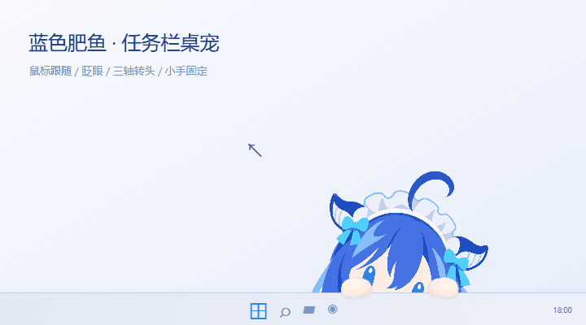
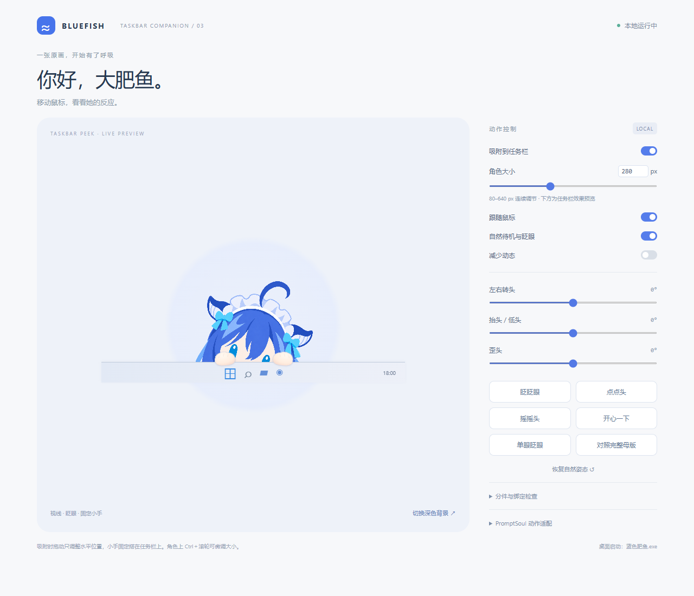
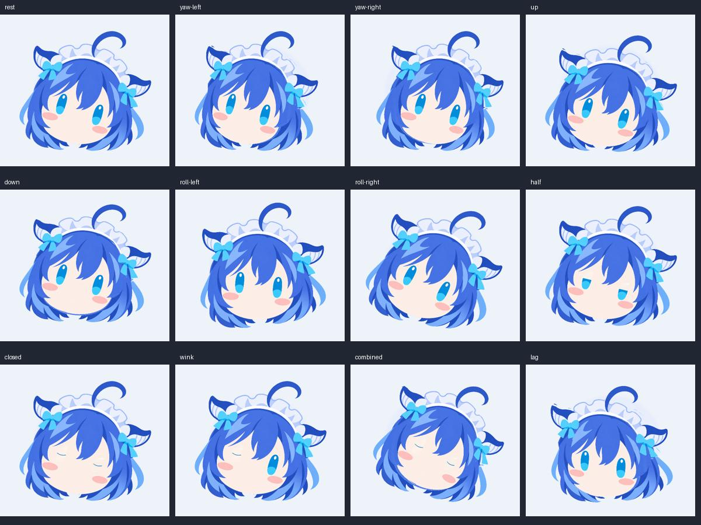

# Bluefish Desktop · 蓝色肥鱼桌面角色

趴在 Windows 底部任务栏上的蓝发桌宠：两只圆圆小手搭住边缘，眼睛和头部跟随鼠标，自动眨眼、轻轻歪头。当前版本 **v0.3.0**，支持 **80–640 px 连续调节大小**，默认 200 px。



上图由程序实际渲染录制，背景任务栏是演示示意。运行后会吸附到你自己的底部任务栏上沿。

**[下载 Windows 运行包](https://github.com/fupangzhu/bluefish-desktop/releases/latest) · [编辑器使用说明](docs/editor.md) · [查看完整头部动画](docs/demo.gif)**

## 下载运行

从 [Releases](https://github.com/fupangzhu/bluefish-desktop/releases/latest) 下载 `bluefish-desktop-v0.3.0-windows-x64.zip`，完整解压后双击 **蓝色肥鱼.exe**。角色会在右下角从任务栏后探出头来，无需安装 Node、Python 或填写 API Key。请保留整个目录，不能只移动 EXE；运行时已包含在下载包内。

源码仓库不包含编译后的 EXE 和 node_modules；从源码运行请看文末的开发说明。独立 PNG 分件包也提供在 Release 中。

## 使用

- **任务栏吸附**：头部下方藏在任务栏后，两只小手固定搭在上沿；转头时手不跟着晃。按住角色左右拖动，调整所在位置。
- **自由调大小**：右键 →「调节大小 / 打开编辑器」，拖动滑杆或输入 80–640 的整数；鼠标放在角色上，`Ctrl＋滚轮` 每次微调 8 px。右键也有常用尺寸预设。
- **完整头部**：取消「吸附到任务栏」后恢复完整头部，可以上下左右拖动。母版轮廓完整；任务栏模式的下沿遮挡是有意的探头效果。
- **动画**：视线和头部跟随整个桌面的鼠标，自动眨眼、呼吸和轻微发梢摆动；右键可触发眨眼、单眼眨眼、点头、摇头、开心，开关跟随和待机。
- **点击**：单击眨眼，移动至少 5 个逻辑像素才开始拖动；透明区域与任务栏下方隐藏的头部不拦截点击，小手所在小区域仍可交互。
- 系统托盘有角色图标，可显示 / 隐藏或退出。
- `Ctrl+Shift+F10` 显示 / 隐藏，`Ctrl+Shift+F11` 恢复右下角位置。
- 保留原母版的无嘴表情。本角色是完整头部特写，没有添加身体。

尺寸使用 Windows 逻辑像素（DIP），显示缩放会影响屏幕上的实际像素。位置、大小和吸附开关会自动保存。由旧版升级时，首次重置为 200 px 的任务栏模式。

## 编辑器

角色右键 → **调节大小 / 打开编辑器**。尺寸与吸附开关会实时作用到桌面角色；三个角度滑杆、母版对照、分件检查、动作按钮和 JSON 曲线用于在工作台内试播动作。桌面即时动作通过角色右键触发。



详见 [编辑器说明](docs/editor.md)，包括如何显示完整头部、检查 PNG 分件、导入动作和恢复默认位置。

## PNG 分件和绑定

`assets/layers/` 内有 19 张 2048×2048 RGBA PNG，所有坐标固定：

body、hair_back、face、ear_l、ear_r、eye_l_open/half/closed、eye_r_open/half/closed、blush_l、blush_r、mouth、hair_front、ahoge、headdress、bow_l、bow_r。

body.png 和 mouth.png 是有意保留的空透明层，因为母版没有身体和嘴。其余 17 张有内容。眼睛三态共用绑定包围盒与中心；半闭眼保留原眼睛像素位置，通过上眼睑遮挡，闭眼是程序绘制的弧线。

v0.3 新增的两只小手复用独立的 `assets/hand.svg`，由代码绘制圆润轮廓，右手镜像。它们是固定在任务栏线上的独立覆盖层，不混入头部 PNG 或转头网格。

- `assets/master-source.png`：生图模型返回的完整头部候选，原生 1254×1254。
- `assets/master.png`：清理透明边缘、规范实色区 alpha 后，Lanczos 重采样到 2048 的固定母版。不是原生 2K 生图。
- `assets/reconstructed.png`：按绑定顺序叠加分件的检查图。
- `assets/rig.json`：层顺序、各层枢轴、深度、包围盒、眼睛变体及补底记录。
- `assets/split-validation.json`：分件和叠加的量化检查结果。
- `tools/build_complete_rig.py`：可复现的分件与补底脚本，需要 Pillow 和 NumPy。

绑定已在本程序中实际运行：后发、脸、耳鳍、眼睛、腮红、刘海、蕾丝、蝴蝶结、呆毛分别绘制，使用弯曲网格和不同控制枢轴；后发、蝴蝶结和呆毛有跟随延迟。范围为左右 ±18°、上下 ±12°、侧倾 ±10°。

这是 **自定义 WebGL 分层网格绑定**，不包含 Live2D Cubism 的 .moc3 工程，不能直接作为 Cubism 模型导入其他播放器。支持头像小幅转动，不提供真实侧面或背面。

## 补绘与对齐说明

可见像素主要来自固定母版；脸部遮挡区、眼睛与腮红后的皮肤、后发底板以及附件根部做了代码补底。闭眼线是新增动画形态。因此不声称所有图层都是原图无损擦除。

12px 重叠只在有上层遮挡的连接边缘加入；外轮廓不外扩成色边，眼睛、腮红、蝴蝶结等没有可隐藏外扩空间的边缘保持原有轮廓。无姿态时重叠合成与固定母版的平均 RGBA 通道误差约 0.124 / 255；少量抗锯齿边缘存在差异，并非像素完全相同。

## PromptSoul

保留 PromptSoul 已解析动作 segment 的离线参数适配，支持 ParamAngleX/Y/Z、ParamEyeLOpen/ROpen、ParamEyeBallX/Y。工作台的“播放适配示例”可直接验证；未知参数和没有归零的曲线会被拒绝。聊天、语音、提示词生成动作服务没有接入，也不需要它们才能运行角色。

## 验证与开发

通过 15 项动作、拖动与布局单元测试，以及原有 4 项 PNG 合同检查。Chromium 检查了固定小手、隐藏头部的点击穿透、96 px 小尺寸、153 px 数字输入和吸附切换。

真实 Windows / Electron 在 150% 显示缩放下验证：30 次点击与 30 次拖动更新不累积放大；200 px 角色画布保持 200 px。80 / 113 / 200 / 333 / 640 px 吸附边缘均对齐任务栏，编辑器能实时调整桌面尺寸。系统换算可能令原生窗口边框有 1 DIP 舍入差异。



从源码开始（需要 Node.js 22.12+，桌面模式需要 Windows）：

```powershell
git clone https://github.com/fupangzhu/bluefish-desktop.git
cd bluefish-desktop
npm ci
node node_modules/electron/install.js
npm test
npm start
```

`npm run preview` 启动本地浏览器工作台，默认地址 http://127.0.0.1:8766 。

Windows 原生点击回归检查：

```powershell
node_modules\electron\dist\electron.exe test\click-window.cjs
node_modules\electron\dist\electron.exe test\taskbar-window.cjs
```

测试输出和隔离配置保存在 .test-output/，不会进入 Git。重建 PNG 分件需要 Python、Pillow 和 NumPy：`python tools/build_complete_rig.py`。

可选 EXE 启动器的源代码位于 tools/BluefishLauncher.cs；源码运行直接使用 npm start 即可。

设置保存在系统应用数据目录 bluefish-complete/window.json。吸附按显示器的工作区底边计算，面向底部且常显的 Windows 任务栏；自动隐藏任务栏时，角色停留在工作区底边。程序不修改任务栏或开机启动，不访问摄像头或麦克风，不发送聊天或图片到外部服务。
