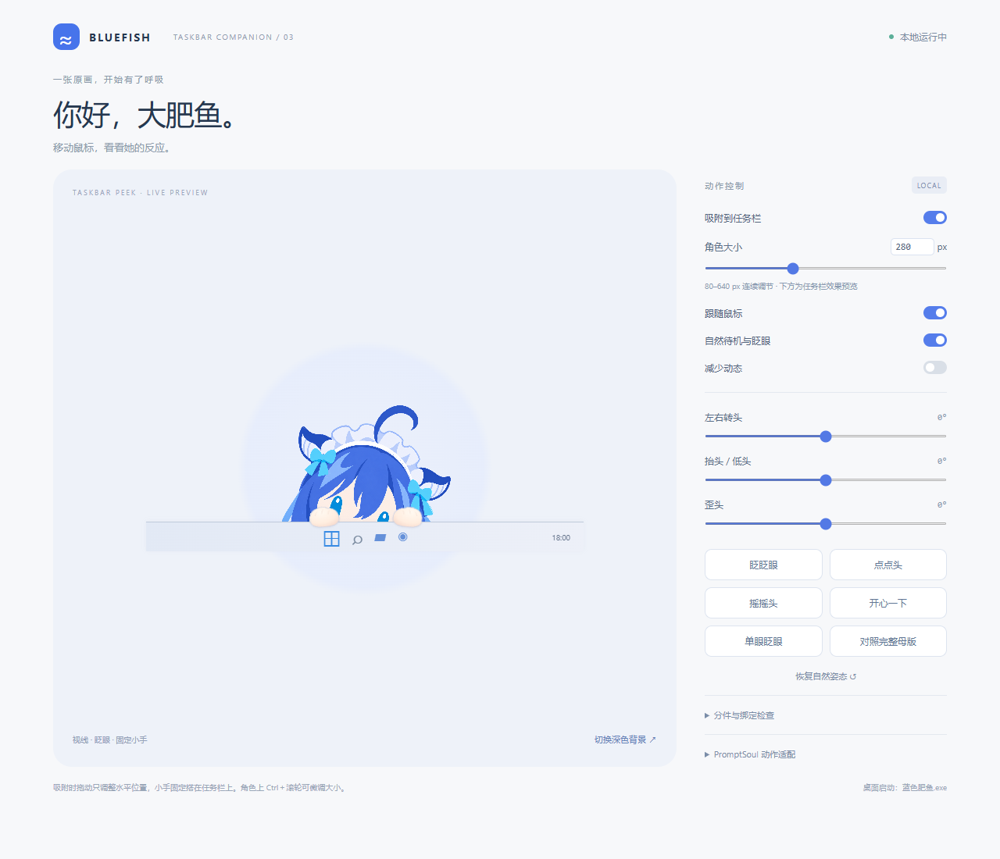

# 编辑器与任务栏模式



## 打开和调整大小

1. 启动 `蓝色肥鱼.exe`，在角色或小手上点击右键。
2. 选择「调节大小 / 打开编辑器」。这是内置窗口，无需单独安装 Node.js。
3. 拖动「角色大小」滑杆，或输入 **80–640** 的整数。80 px 比旧版最小尺寸小得多，默认 200 px；喜欢小桌宠可试 100–140 px。
4. 「吸附到任务栏」开启时，尺寸变化后仍保持贴住任务栏上沿；按住角色可左右拖动。

鼠标放在角色上时，按住 **Ctrl＋滚轮** 可每次增减 8 px。普通单击只眨眼，不会放大。屏幕显示缩放比例会影响实际物理大小。

大小、吸附开关与位置会保存，下次启动恢复。在双屏间拖动会以鼠标所在显示器的工作区重新定位。

## 任务栏与完整头部

| 模式 | 画面 | 拖动 |
| --- | --- | --- |
| 吸附开启 | 头部从任务栏后探出来，两只圆圆小手固定搭在边缘 | 沿任务栏左右移动 |
| 吸附关闭 | 显示完整头部，不显示任务栏小手 | 自由上下左右移动 |

工作台的任务栏条是示意背景。桌面模式使用 Windows 的真实任务栏位置，两只小手最多覆盖上沿 6 个逻辑像素；小手下面的其余任务栏区域可正常操作。

底部常显任务栏效果最佳。自动隐藏任务栏时，角色仍以工作区底边定位，不会检测任务栏的临时弹出动画。没有修改系统任务栏设置。

## 动作与分件

尺寸与吸附开关在**内置编辑器**中会实时控制桌面角色。其余动作工具在左侧预览中试播：

| 控件 | 用法 |
| --- | --- |
| 跟随鼠标 | 预览跟随工作台内鼠标；桌面角色始终按自己的跟随开关读取全局鼠标 |
| 自然待机 / 减少动态 | 调整预览的眨眼、轻微摆动和缓动 |
| 左右转头 / 抬头低头 / 歪头 | 分别预览 ±18° / ±12° / ±10°；调角度时关闭预览鼠标跟随 |
| 眨眼 / 点头 / 摇头 / 开心 / 单眼眨眼 | 在预览中试播一次动作 |
| 恢复自然姿态 | 清除预览姿态与临时动作，恢复鼠标跟随 |
| 对照完整母版 | 对照头部原画，再点一次退出；建议先关闭吸附，以查看全图 |
| 分件与绑定检查 | 展开下拉列表单独查看 PNG 层；检查后选「显示完整绑定角色」；底部图层需先关闭吸附 |
| PromptSoul 动作适配 | 载入已解析的 segment JSON 或本项目参数曲线，点击「播放适配示例」快速试播 |

若要让桌面角色立即执行动作，使用**角色右键菜单**。姿态滑杆不写入永久绑定，也不会改写 PNG。当前编辑器用于预览已有绑定与播放参数曲线，不提供 Cubism 网格编辑或 `.moc3` 导出。

`body.png` 和 `mouth.png` 是空透明层，来自没有身体和嘴的头部设计。任务栏小手是独立 `assets/hand.svg`，左右共用并镜像，不随头部旋转。PNG 包内仍为 19 张头部分件。

## 从源码打开浏览器工作台

```powershell
npm ci
npm run preview
```

打开终端显示的本地地址（默认 `http://127.0.0.1:8766`）。浏览器工作台是独立预览，不能控制另一个进程里的桌面角色；要实时调整桌面大小，请通过角色右键打开内置编辑器。

独立脚本「启动动作工作台.cmd」同样需要 Node.js；Windows 运行包内的内置编辑器不需要。

## 找回角色与退出

- `Ctrl+Shift+F10` 或托盘图标：显示 / 隐藏角色。
- `Ctrl+Shift+F11` 或右键「回到右下角」：恢复到主显示器右下角，保留所选大小与吸附模式。
- 右键「退出蓝色肥鱼」关闭程序；关闭编辑器窗口不会退出角色。

升级自 v0.2 时首次会切换为新的 200 px 任务栏布局。此后设置位于 `%APPDATA%/bluefish-complete/window.json`。
