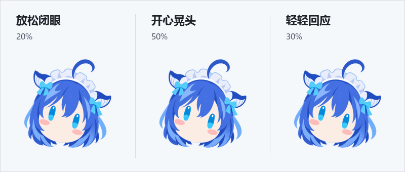
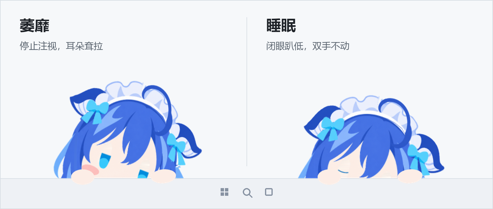
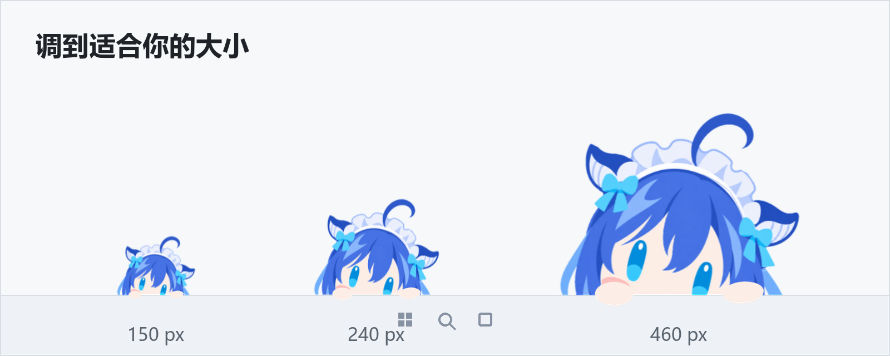
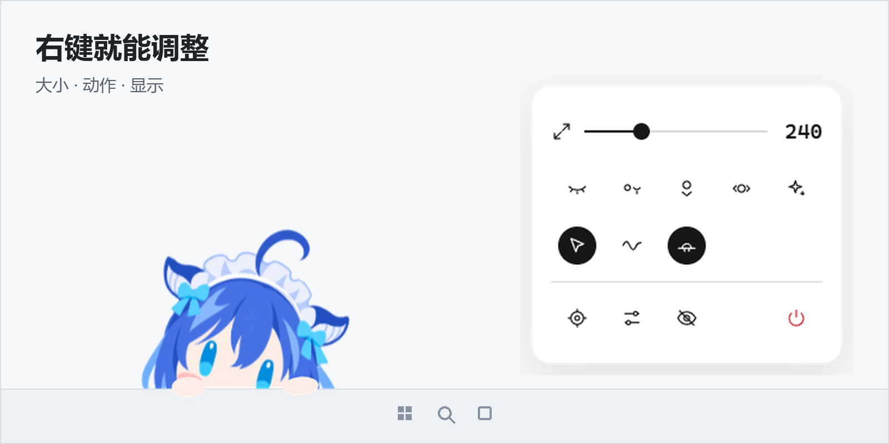
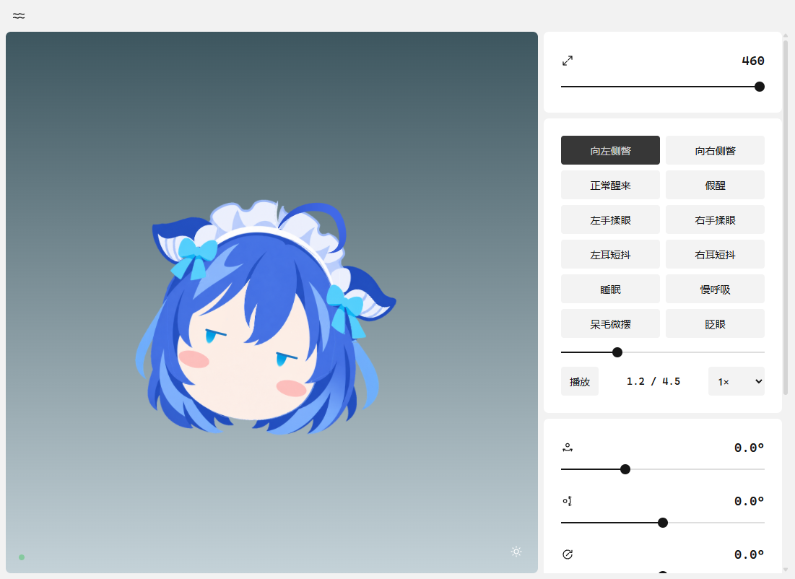

# 使用说明

## 互动

把鼠标移到脑袋附近，来回揉一揉。每次会随机选一种反应，连续揉头时保持同一种。



- **20% · 放松闭眼**：慢慢闭眼、停稳；离开后等 2–5 秒，再睁眼恢复移动。
- **50% · 开心晃头**：睁着眼睛晃脑袋，呆毛跟着轻摆。
- **30% · 轻轻回应**：小幅摇晃，反应更安静。

捏住呆毛拖动，会先拉直、再回弹；点击哪只耳朵，哪只就快速抖一两下。

## 状态

光标久停或离远后，她会停止注视，渐渐萎靡。**2 分钟**未互动后开始随机入睡，最迟 **10 分钟**一定睡着。



睡着后趴得更低，耳朵更耷拉，小手仍搭在任务栏上。偶尔单耳短促抖一下，伴随极轻的慢呼吸和呆毛轻摆。只有点击角色才会唤醒，靠近或揉动不会打扰睡眠。醒来时随机播放慢慢醒来、轻轻伸展或左右张望，约 12% 的机会先揉眼睛、再慢慢睁眼。

## 开始使用

1. 打开 [Releases](https://github.com/fupangzhu/bluefish-desktop/releases/latest)，下载 `bluefish-setup-*.exe`。
2. 双击安装，启动后常驻托盘；也可以下载便携 ZIP，完整解压后运行 `蓝色肥鱼.exe`。
3. 拖到任务栏边缘即可贴边，向上拖动可切换为悬浮头像。

上方演示对应 **v0.6.6**，包含随机揉头、闲置睡眠和点击唤醒。安装包与便携版的版本及更新内容见 [Releases](https://github.com/fupangzhu/bluefish-desktop/releases/latest)。

| 操作 | 方法 |
| :--- | :--- |
| 调整大小 | 右键滑块，或在角色上按住 `Ctrl` 滚动鼠标滚轮 |
| 移动位置 | 贴边时左右拖动；向上拖成悬浮，拖回底部自动吸附 |
| 显示 / 隐藏 | 托盘菜单，或 `Ctrl` + `Shift` + `F10` |
| 回到原位 | `Ctrl` + `Shift` + `F11` |
| 退出程序 | 右键菜单中的电源按钮 |

## 调整与控制

大小支持 **150–460** 无级调节，贴边与悬浮共用同一套动作。



### 右键菜单

快速调整大小、切换鼠标跟随与待机动作，也可以隐藏角色或打开控制台。



### 控制台

实时预览角色，调节左右转头、抬头低头和侧向倾斜；也可以导入动作 JSON、单独查看 PNG 图层。



## 从源码运行

需要 Windows 10 / 11 x64 和 Node.js 22 或更高版本。

```powershell
git clone https://github.com/fupangzhu/bluefish-desktop.git
cd bluefish-desktop
npm ci
npm start
```

`npm run preview` 可打开浏览器预览；`npm test` 运行逻辑测试。

角色使用固定坐标的分层 PNG 和 WebGL 网格绑定驱动，不依赖 Live2D。

| 文档 | 内容 |
| :--- | :--- |
| [开发说明](../DEVELOPMENT.md) | 项目结构、调试、交互回归与 Windows 打包 |
| [素材制作](../tools/docs/README.md) | 从真实界面重新生成本页图片和动画 |
| [更新记录](release-notes.md) | 各版本的动作与功能变化 |
